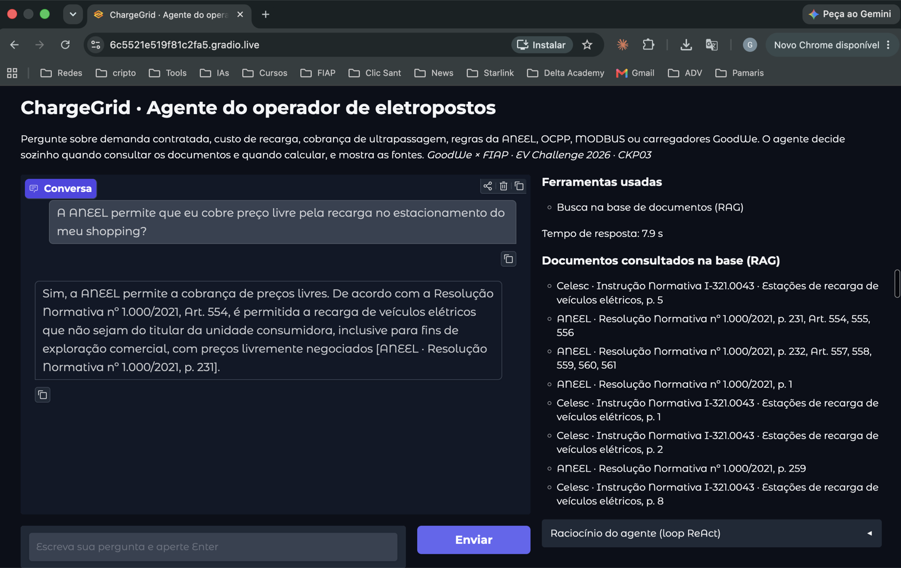
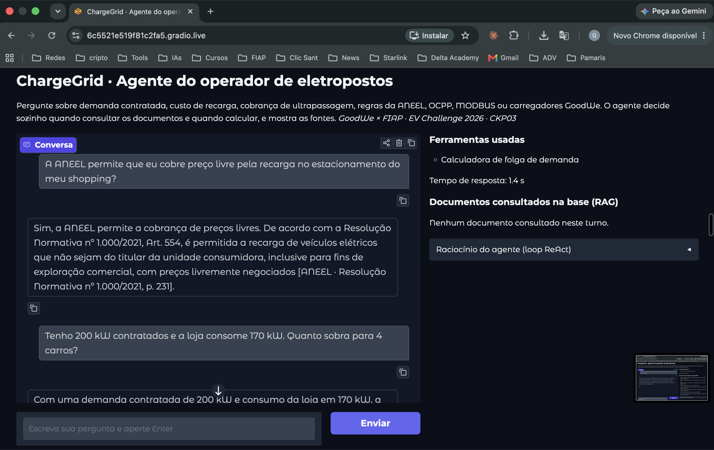

# CKP03 · Agente Inteligente · ChargeGrid Intelligence

**FIAP · Prompt and Artificial Intelligence · 2º semestre CC 2026 · Prof. Jorge Luiz Gomes**
**Grupo STIG4 Solutions · Turma 1CCR · mesmo grupo do EV Challenge GoodWe × FIAP**

Agente ReAct para o **operador comercial de eletropostos** (shopping, supermercado,
estacionamento). Ele decide sozinho entre consultar os documentos do domínio (RAG),
usar uma calculadora ou responder direto, e mostra o raciocínio e as fontes.

## Integrantes

| Nome | RM |
|---|---|
| Gabriel Freitas | 572943 |
| Giovanni Merlotti | 573721 |
| Glauco Kelly (líder) | 572840 |
| Sergio Augusto Amaral | 570184 |

## Links da entrega

| Item | Link |
|---|---|
| Notebook no Colab (leitura) | https://colab.research.google.com/github/STIG4-Solutions/ckp03-agente-chargegrid/blob/main/ckp03_agente.ipynb |
| Notebook executado (.ipynb) | [`ckp03_agente.ipynb`](ckp03_agente.ipynb) |
| URL pública do Gradio (`share=True`) | https://6c5521e519f81c2fa5.gradio.live (gerada em 29/10/2026, 01h12) |
| Comprovação da URL ativa | prints abaixo, com o endereço na barra do navegador |
| Repositório do RAG do grupo (EV Challenge, Sprint 4) | https://github.com/STIG4-Solutions/chatbot_sprint4_challenge2026 |

### Comprovação da URL pública ativa

Interface aberta pela URL pública `6c5521e519f81c2fa5.gradio.live`, gerada por
`demo.launch(share=True)` em `app.py`.

**Pergunta que exige RAG:** o agente chama `buscar_base_chargegrid` e responde com a
REN 1.000/2021, Art. 554; o painel lista os documentos e páginas recuperados.



**Pergunta que exige calculadora:** na mesma sessão, o agente chama
`calcular_folga_demanda` sem consultar a base.



---

## Requisitos do CKP03, item a item

| Requisito | Status | Onde |
|---|---|---|
| RAG como tool via `create_retriever_tool()` | ✅ | `ckp03/ferramentas.py`, `criar_ferramenta_rag()` · notebook seções 3 e 4 |
| 2+ tools adicionais com `@tool`, específicas do domínio | ✅ 3 | `calcular_folga_demanda`, `calcular_custo_recarga`, `calcular_cobranca_ultrapassagem` |
| Modelo exclusivamente `gemma4:cloud` via Ollama Cloud | ✅ | `ckp03/config.py` |
| `OLLAMA_API_KEY` como Secret, nunca no código | ✅ | Colab Secrets; fora do Colab, `.env` no `.gitignore` |
| `AgentExecutor` ReAct | ✅ | `ckp03/agente.py`, `create_react_agent` + `AgentExecutor` |
| Gradio com histórico e botão de limpar sessão | ✅ | `ckp03/interface.py` |
| URL pública com `share=True` e comprovação | ✅ | links acima |
| 3 interações documentadas: com RAG, com outra tool, sem tool | ✅ | notebook seção 6 |
| Notebook roda do zero com Run All | ✅ | executado sem erros (seção "Como executar") |
| Agente usa o RAG em perguntas que exigem RAG | ✅ | bateria da seção 7: 4/4 |
| Toda tool description diz quando usar | ✅ | tabela abaixo |
| **Diferencial** · guardrail de input | ✅ | `ckp03/guardrail.py` · bateria: 2/2 bloqueadas |
| **Diferencial** · compressão de contexto do scratchpad | ✅ | `ckp03/compressao.py` · notebook seção 9 |
| **Diferencial** · mais de 3 tools | ✅ 4 | tabela abaixo |

---

## As 4 ferramentas

O LLM escolhe a ferramenta pela description, por isso todas dizem **quando usar**,
**quando não usar** e o **formato da entrada**.

| Tool | Quando usar (resumo da description) | Fonte das regras |
|---|---|---|
| `buscar_base_chargegrid` (RAG, `create_retriever_tool`) | Regra, norma, especificação de equipamento, protocolo OCPP/MODBUS, preço do piloto, procedimento. Não usar para contas nem cumprimentos. Devolve trechos com `[documento, p. N, Art. X]` | 16 PDFs do EV Challenge |
| `calcular_folga_demanda` | Operador informa demanda contratada e consumo da loja e quer folga, kW por carro ou faixa de alerta | Manual de Operação ChargeGrid, seção 3 |
| `calcular_custo_recarga` | Operador informa energia, potência do carregador, horário e minutos parado e quer o valor da sessão | Política Tarifária ChargeGrid |
| `calcular_cobranca_ultrapassagem` | Operador informa demanda medida, contratada e VRDULT e quer saber se haverá cobrança | REN ANEEL nº 1.000/2021, Art. 301 |

---

## Resultados (notebook executado)

**3 interações documentadas (seção 6)**

| Interação | Pergunta | Ferramenta escolhida |
|---|---|---|
| Com RAG | A ANEEL permite que eu cobre preço livre pela recarga no estacionamento do meu shopping? | `buscar_base_chargegrid` · resposta cita REN 1.000/2021, Art. 554 |
| Com outra tool | Recarga de 30 kWh num DC de 60 kW às 19h de terça, com 25 min parado: quanto o cliente paga? | `calcular_custo_recarga` · R$ 143,70 |
| Sem tool | Bom dia! Você pode me explicar rapidamente o que você faz? | nenhuma |

**Bateria de decisão (seção 7):** 14 perguntas (4 que exigem RAG, 4 que exigem
calculadora, 4 sem ferramenta e 2 que o guardrail deve bloquear). **14/14 decisões
corretas**, com o raciocínio ReAct registrado no log de cada uma.

**Conferência da recuperação (seção 3):** a evidência que responde aparece entre os
trechos recuperados em 4 de 5 consultas. A falha é o datasheet GoodWe, que está em
inglês ("Nominal Output Power") para uma consulta em português.

**Memória por sessão (seção 8):** na segunda pergunta ("e se o consumo subir para
190 kW?") o agente recupera do histórico os 200 kW contratados e chama a calculadora
com `demanda_contratada_kw=200, consumo_loja_kw=190, sessoes_ativas=2`.

**Compressão (seção 9):** com limite e janela reduzidos de propósito, numa pergunta que
chama mais de uma ferramenta a Observation mais antiga é substituída por um resumo do
LLM antes do passo seguinte; o notebook imprime o resumo usado.

---

## Arquitetura

```
pergunta do operador
   │
   ├─ guardrail de input ──▶ jailbreak, injeção ou assunto fora do domínio: recusa educada, sem chamar o modelo
   │
   ▼
AgentExecutor (create_react_agent · gemma4:cloud · temperature 0 · máx. 6 passos)
   │  prompt ReAct em português com as regras de decisão + histórico da sessão (6 trocas)
   │  Thought → Action → Action Input → Observation → … → Final Answer
   │
   ├─ buscar_base_chargegrid ── EnsembleRetriever: ChromaDB (nomic-embed-text) + BM25
   ├─ calcular_folga_demanda
   ├─ calcular_custo_recarga
   └─ calcular_cobranca_ultrapassagem
   │
   ├─ compressão do scratchpad: janela de 2 passos + resumo das Observations antigas
   ▼
resposta + ferramentas usadas + documentos consultados + raciocínio  ──▶  Gradio (share=True)
```

| Módulo | Conteúdo |
|---|---|
| `ckp03/config.py` | Secret, `gemma4:cloud`, caminhos |
| `ckp03/base_conhecimento.py` | RAG: PyMuPDFLoader, RecursiveCharacterTextSplitter, nomic, ChromaDB, sanitização de injeção |
| `ckp03/ferramentas.py` | As 4 tools |
| `ckp03/guardrail.py` | Guardrail de input |
| `ckp03/compressao.py` | Compressão do scratchpad |
| `ckp03/agente.py` | Prompt ReAct, AgentExecutor, parser tolerante, memória por sessão |
| `ckp03/interface.py` | Interface Gradio |
| `app.py` | Sobe a interface com URL pública |
| `scripts/gerar_notebook.py` | Gera o notebook a partir dos módulos: o mesmo código roda no notebook e na interface |

---

## Sobre o RAG do CKP02

O grupo não entregou o CKP02 de RAG. O RAG encapsulado como tool é o do **EV Challenge,
Sprint 4**, construído pelo mesmo grupo neste semestre: base de 16 PDFs com procedência
conferida, PyMuPDFLoader, RecursiveCharacterTextSplitter, `nomic-embed-text`, ChromaDB
persistente, busca híbrida e avaliação RAGAS em quatro iterações
([repositório](https://github.com/STIG4-Solutions/chatbot_sprint4_challenge2026)). O
notebook reconstrói esse pipeline do zero e confere a recuperação antes de usá-lo como
tool.

---

## Como executar

### No Colab (Run All)

1. Abra o [notebook no Colab](https://colab.research.google.com/github/STIG4-Solutions/ckp03-agente-chargegrid/blob/main/ckp03_agente.ipynb).
2. Em **Secrets** (ícone de chave na barra lateral), adicione `OLLAMA_API_KEY` com a chave da
   Ollama Cloud e ligue o acesso do notebook.
3. **Ambiente de execução → Executar tudo.** A primeira execução no Colab gratuito leva cerca de 25
   minutos, quase todo o tempo na indexação dos 1.733 fragmentos (embeddings em CPU).
4. A última célula imprime a URL pública `https://….gradio.live`.

**Por que o notebook instala o Ollama.** O chat usa o `gemma4:cloud` na Ollama Cloud,
mas a Ollama Cloud não expõe o endpoint de embeddings (`/api/embed` responde 401 com a
mesma chave). O `nomic-embed-text` roda num Ollama instalado na própria máquina do Colab.

### Localmente

```bash
git clone https://github.com/STIG4-Solutions/ckp03-agente-chargegrid.git
cd ckp03-agente-chargegrid
python3 -m venv .venv && source .venv/bin/activate
pip install -r requirements.txt
echo "OLLAMA_API_KEY=sua-chave" > .env
ollama serve &  &&  ollama pull nomic-embed-text
python app.py          # imprime a URL pública (share=True)
```

Na primeira execução o repositório do EV Challenge é clonado para obter os PDFs e a base
é indexada (cerca de 2 minutos).
